<div align="center">

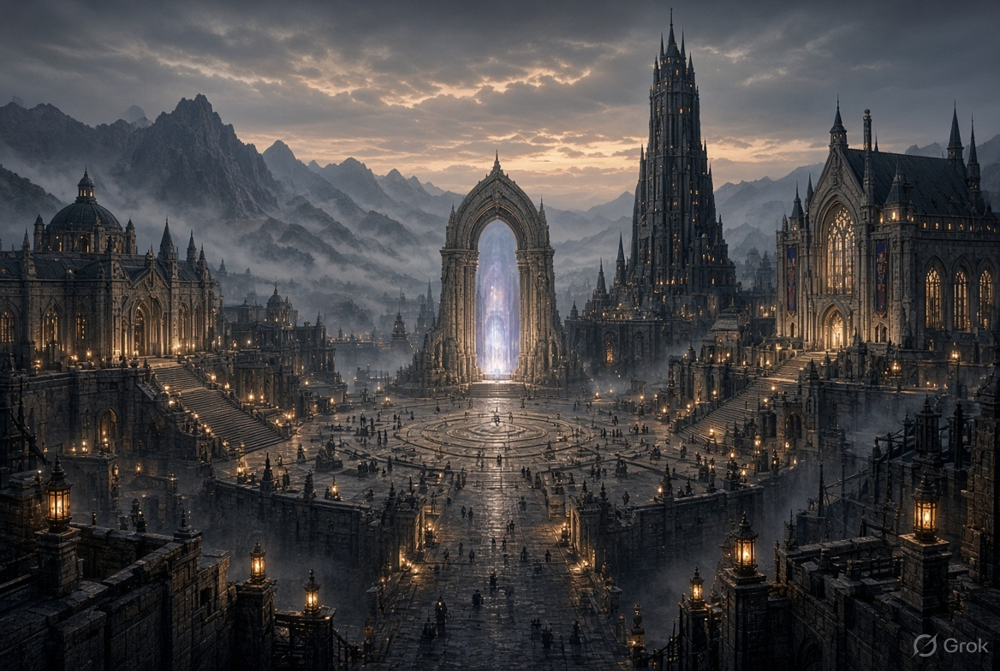

# ✦ STARHAVEN ✦
### *The Sundered Age*

*"They did not build a kingdom. They built a wall between the world and the dark."*


**An original dark-fantasy universe** — a novel, an interactive wiki, a military registry, an atlas, a bestiary, thirty original songs and a whole kingdom's worth of lore, built from the ground up.

[The World](#-the-world) · [The Eleven](#-the-eleven-pillars) · [The Story](#-the-story) · [The Kingdom](#-the-kingdom) · [The Void](#-the-void) · [Inside the Wiki](#-inside-the-wiki) · [Timeline](#-the-timeline)

</div>

---

## ✦ The World

In the year **1032 of the Sundered Age**, a man named **Rayden Cale** built a kingdom on land no one else wanted to defend.

He did not do it alone.

Starhaven is the story of what happens *after* the hero survives — when survival demands nation-building, when soldiers become ministers, when the thing chasing the world across the dark refuses to stop. Military-political dark fantasy: grounded, competent, earned. **No prophecies. No chosen ones. Only the Eleven, and the choices they make.**

Magic is everyday here — rune-lit doors, mana lamps, crystal-powered trains, tide-mages keeping the ferries calm. And at the edge of everything, the **Void**: a spreading corruption anchored to something called **Malgrath**, which exactly one person alive can see.

---

## ✦ The Eleven Pillars

Starhaven is ruled by eleven people. Each commands an army. Each holds a Pillar — one domain of absolute authority.

<div align="center">
<table>
<tr>
<td align="center" width="16%">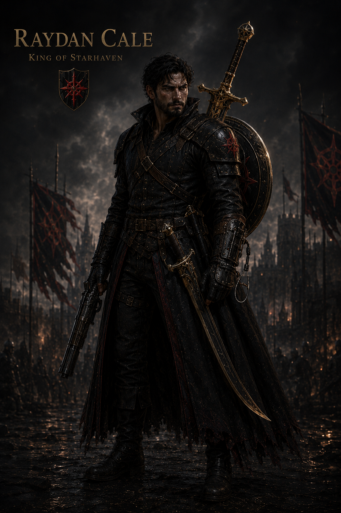<br><b>Rayden Cale</b><br><sub>The Dawn · King</sub></td>
<td align="center" width="16%">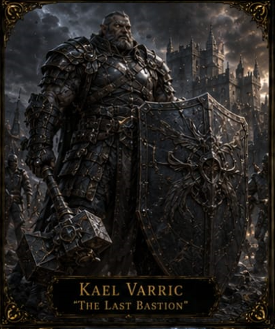<br><b>Kael Varric</b><br><sub>The Wall · Ironwall</sub></td>
<td align="center" width="16%">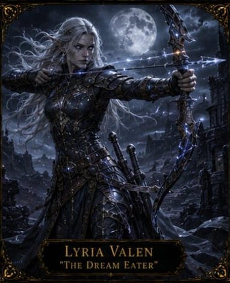<br><b>Lyria Valen</b><br><sub>The Eye · Silent Wardens</sub></td>
<td align="center" width="16%">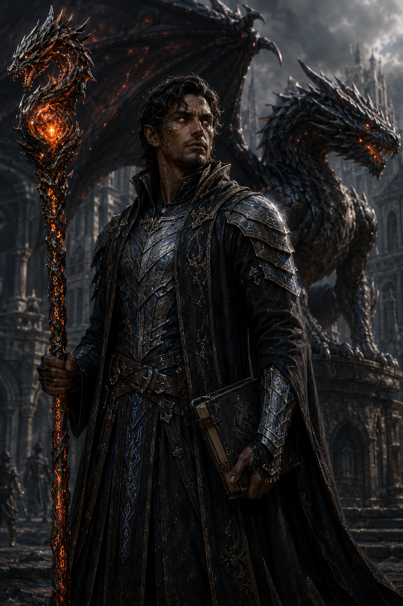<br><b>Velkan Drake</b><br><sub>The Mind · Ninth Sky Corps</sub></td>
<td align="center" width="16%">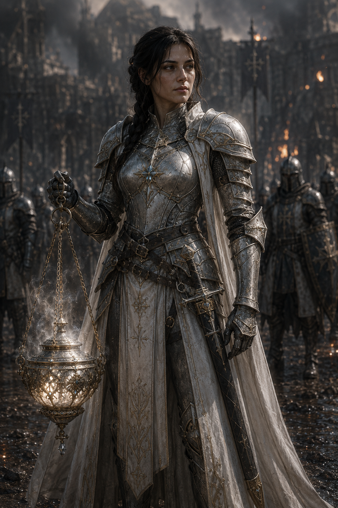<br><b>Seraphine Mire</b><br><sub>The Heart · Ashen Guard</sub></td>
<td align="center" width="16%">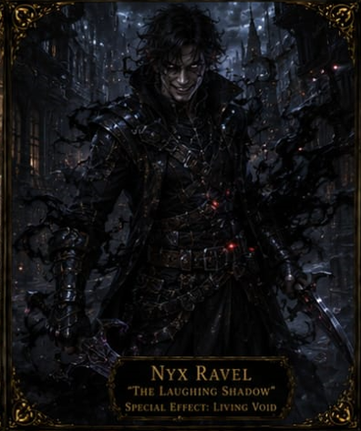<br><b>Nyx Ravel</b><br><sub>Secrets · Null Blades</sub></td>
</tr>
<tr>
<td align="center">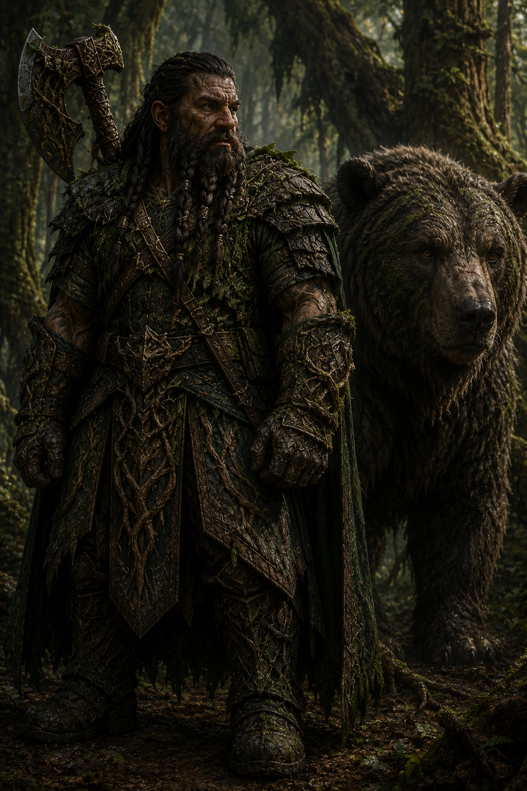<br><b>Thorin Blackroot</b><br><sub>The Land · Primal Vanguard</sub></td>
<td align="center">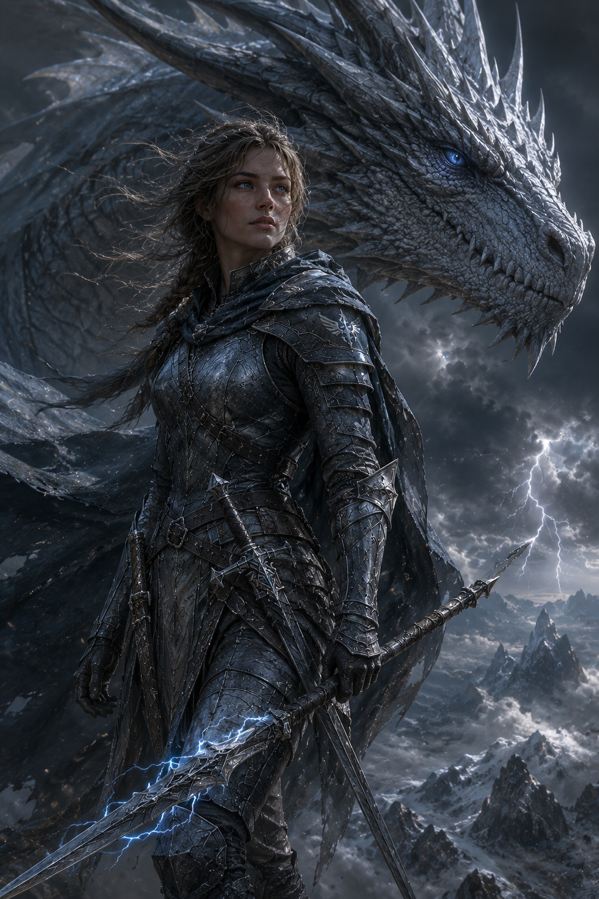<br><b>Aurelia Vex</b><br><sub>The Sky · Stormriders</sub></td>
<td align="center">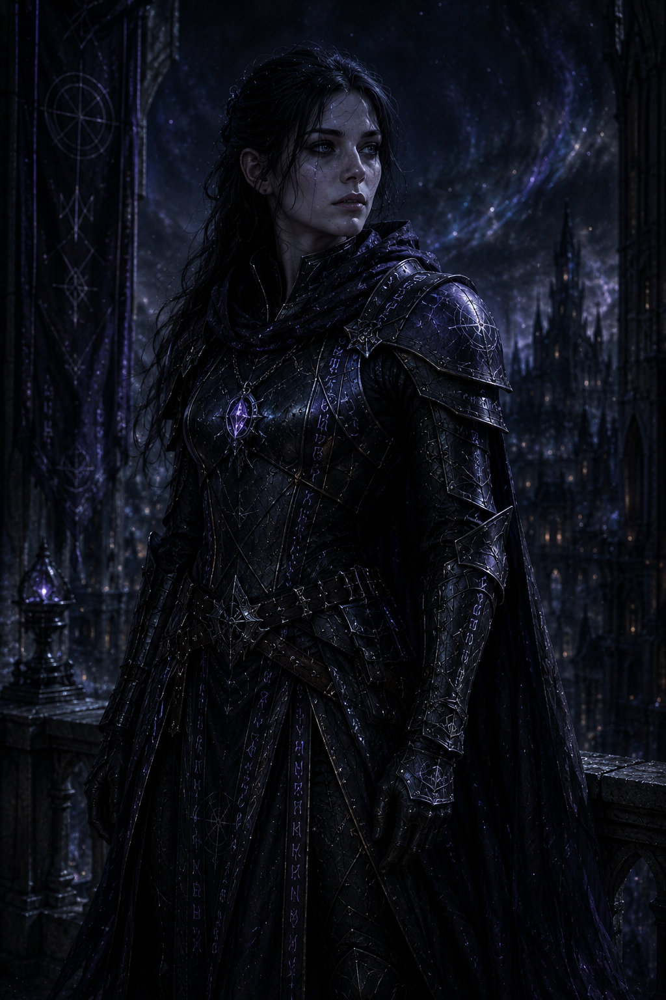<br><b>Elysia Nocturne</b><br><sub>The Veil · Veil Watch</sub></td>
<td align="center">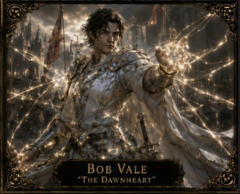<br><b>Bob Vale</b><br><sub>The Bond · Soul Link</sub></td>
<td align="center">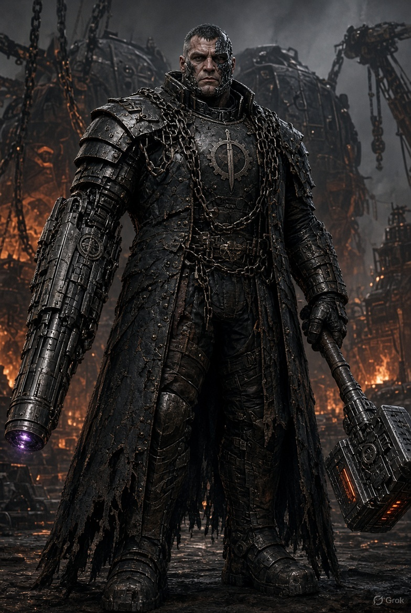<br><b>Cain Drakhar</b><br><sub>Iron · Iron Tide</sub></td>
<td align="center"><br><i>"Only the Eleven,<br>and the choices<br>they make."</i></td>
</tr>
</table>
</div>

<details>
<summary><b>Who they are, in one line each</b></summary>

| Pillar | Name | One line |
|---|---|---|
| The Dawn | **Rayden Cale** | The King. Wields Dawnpiercer & Kingsbane. Fights on foot, with the Dawnguard (480). |
| The Wall | **Kael Varric** | Minister of Defence. 25,000 very heavy infantry. Never lost a fortress. Rides a rhino named DreadMaw. |
| The Eye | **Lyria Valen** | A 127-year-old Moon Elf who reads a landscape like a page. |
| The Mind | **Velkan Drake** | Grand Arcanist, Athenaeum Director, draconic bloodline. Notebook always in hand. |
| The Heart | **Seraphine Mire** | Half-Celestial Saintess. The one who stays when everyone else leaves. |
| Secrets | **Nyx Ravel** | Shadekin. Commander of the Null Blades. Already knows. |
| The Land | **Thorin Blackroot** | Wildblood Dwarf, Lord of Greenveil. One sentence, usually the correct one. |
| The Sky | **Aurelia Vex** | Storm Elf. Already moving before the problem has been described. |
| The Veil | **Elysia Nocturne** | Astralborn. The only one who can see Malgrath. |
| The Bond | **Bob Vale** | The soul-link anchor. |
| Iron | **Cain Drakhar** | Minister of Industry & the Arsenal. 280 Iron Tide tanks. |

</details>

---

## ✦ The Story

<table>
<tr><td>

**Nine chapters**

| | |
|---|---|
| **I** | *The Boy Who Ran Through Fire* — the night Rayden Cale was left alive |
| **II** | *Ashes Before Kingdoms* — mercenary years, Lowmere Field, Selene Voss |
| **III** | *The Wandering Legends* — a man named Kael, a star-eyed huntress |
| **IV** | *The Gathering Storm* — Velkan arrives, the Silverfire Trial |
| **V** | *The Birth of Starhold* — a fortress, a crisis, two shadows |
| **VI** | *The War of Starhold* — a kingdom proclaimed at dawn |
| **VII** | *A New Beginning* — thirteen years of nation-building |
| **VIII** | *A New Beginning (cont.)* — Iron and Archive, Saltmere |
| **IX** | *What the Mountains Sent* — the mountains do not send messengers |

</td><td>

**137 chronicles** carry it on, to about **Year 1059**

| Kind | |
|---|--:|
| ⚔️ Wars | 14 |
| ✦ Legends | 25 |
| 🗺️ Filler arcs | 29 |
| ✎ Short stories | 24 |
| 🌍 Tales from Abroad | 14 |
| 📜 History, fables, politics, letters, magic | 31 |

*The Five Thrones War · Forty Sails · The Siege of Vael'Dorum · The Twilight War · The Tower of Twenty · The Eleventh Letter · The Empty Chair · The Most Polite War*

</td></tr>
</table>

---

## ✦ The Kingdom

<div align="center">
<table>
<tr>
<td align="center"><br><b>Starhold</b><br><sub>The capital · 280,000+</sub></td>
<td align="center">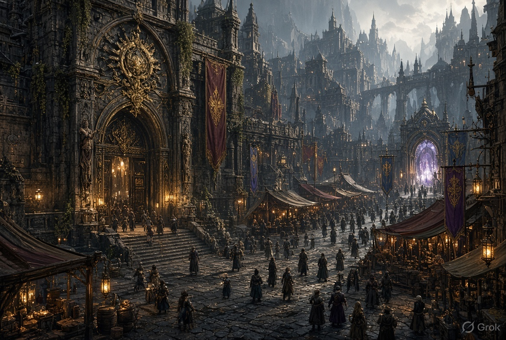<br><b>Goldgate</b><br><sub>Trade & the Guild</sub></td>
<td align="center">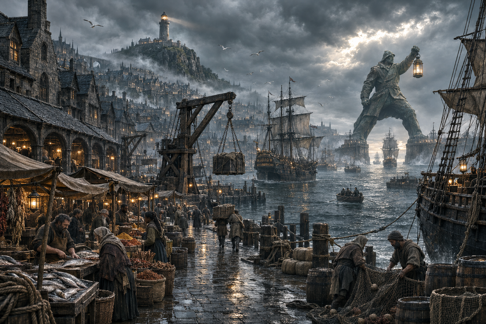<br><b>Saltmere</b><br><sub>The Dawnfleet</sub></td>
<td align="center">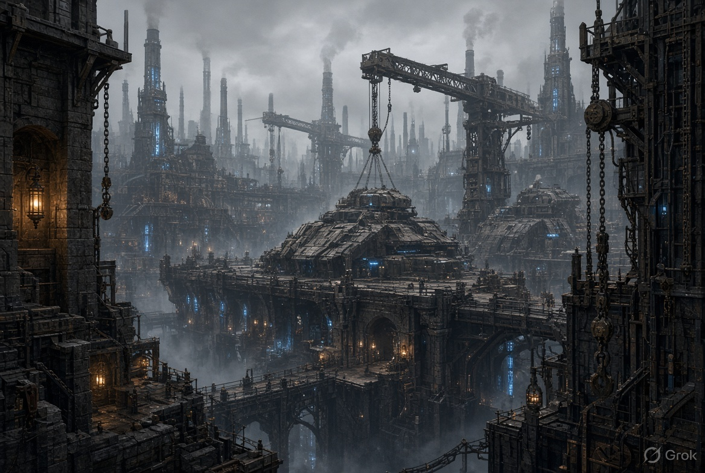<br><b>Forgehaven</b><br><sub>Iron & industry</sub></td>
</tr>
<tr>
<td align="center">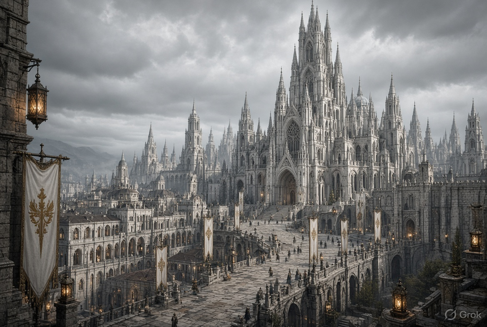<br><b>Sancthaven</b><br><sub>City of healers</sub></td>
<td align="center">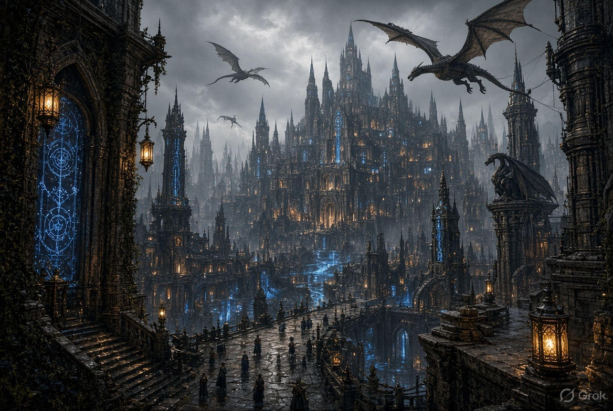<br><b>Vaelmark</b><br><sub>The arcane capital</sub></td>
<td align="center">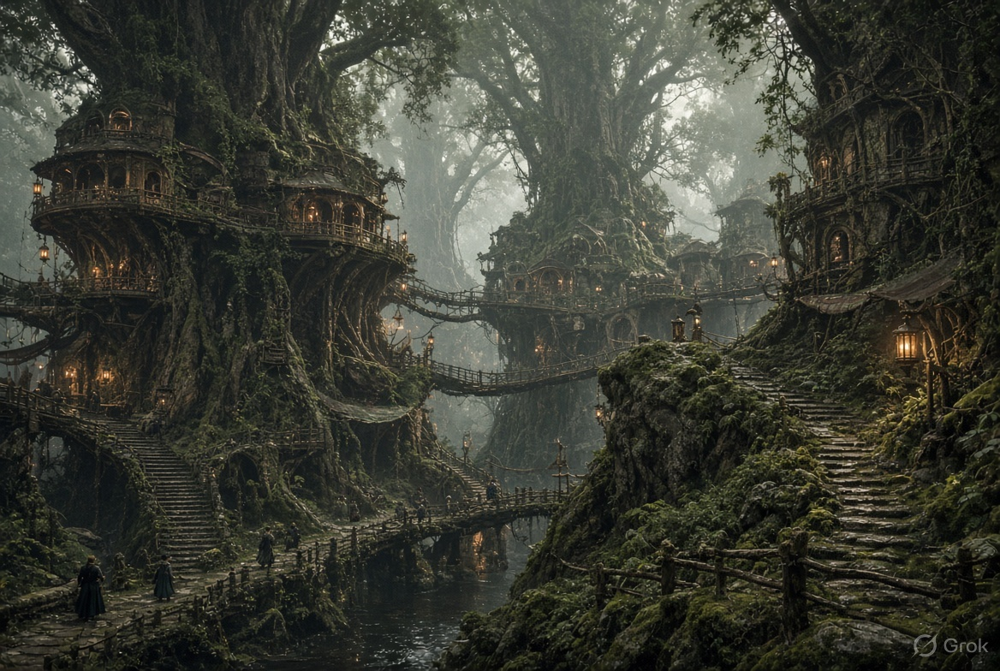<br><b>Greenveil</b><br><sub>Grown, not built</sub></td>
<td align="center"><br><b>+ 141 more</b><br><sub>villages, forts, frontiers,<br>ruins and landmarks —<br>1,000+ places in all</sub></td>
</tr>
</table>
</div>

**Fortresses that have not fallen** — Ironpass Citadel (*no incursion past the second ring since 1041*) · Frosthold Bastion · Dawncliff Sea Fortress (*"Fire for effect, not for warning"*) · Veilhold Keep · Lumenfield HQ · the Saltreach Causeway.

**Beyond the borders** — 36 nations: the Thalassian League, Varathos of the giants, the Karath Sultanate and its old rival Zharak, the Frostspire Dominion, the Stonemark Holds, Karvossa of the vampire houses, the Titan Highlands, the Elderwood, the floating Skyward Isles… and the Nullborn Empire, which is the Void made into a state.

---

## ✦ The Void

> The Void is not a faction. It does not negotiate.

It spreads through land, corrupts matter, and fights through creatures catalogued by **Zareth Kull's Void Breakers** at Lumenfield HQ. The thing at its centre — **Malgrath** — cannot be seen by ordinary means. Only **Elysia Nocturne** can see it, and she has never said what she sees.

Anti-corruption treatment exists for armour. It is not enough.

---

## ✦ Inside the Wiki

<div align="center">
<table>
<tr>
<td align="center">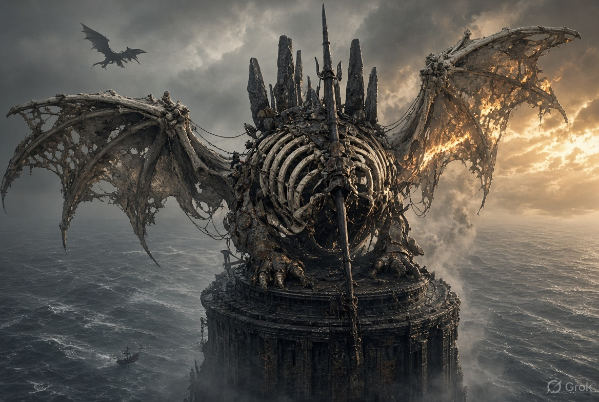<br><sub><b>The Keeper of Twenty</b> · SS+</sub></td>
<td align="center">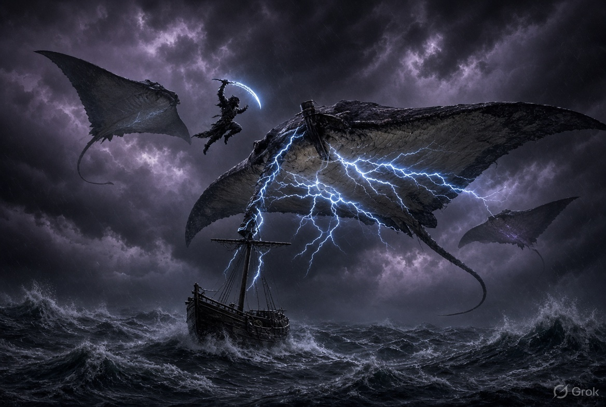<br><sub><b>Storm Ray</b> · B</sub></td>
<td align="center">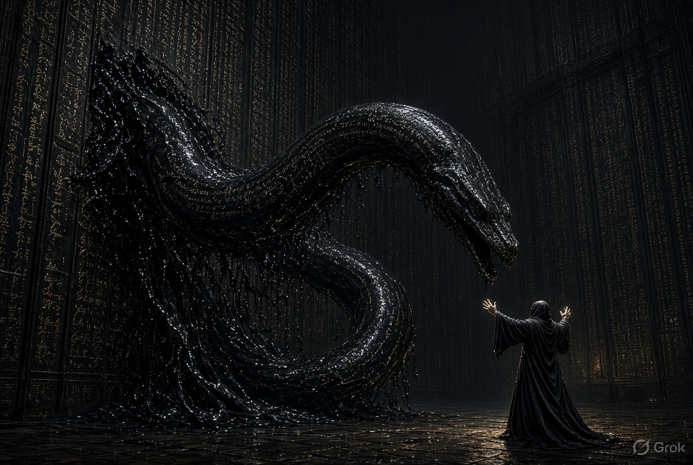<br><sub><b>Inkwyrm</b> · S</sub></td>
<td align="center">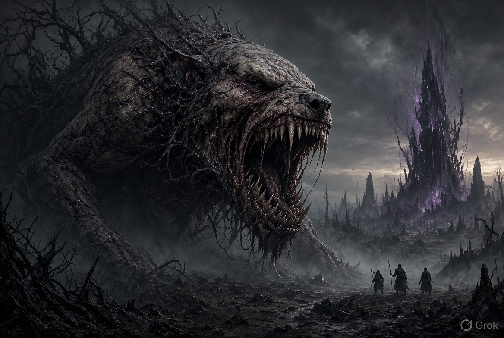<br><sub><b>Voidmaw</b></sub></td>
</tr>
</table>
</div>

`starhaven_wiki.html` — open it in any browser. No install, no server.

| Section | What's there |
|---|---|
| 📖 **Main Story** | The nine chapters |
| 📜 **Chronicles** | 137 stories, filtered by kind, every place and person linked |
| 👤 **Characters** | 482 cards — portraits, abilities, weapons, relationships, histories |
| ⚔️ **Army · Unit Wiki · Nullborn Units** | Every unit, friend and foe |
| 🏰 **Atlas** | 148 locations and 1,000+ places — keepers, lore, *rumours on the boards* |
| 🗺️ **World Map** | The painted map, and a **Kingdom plan** drawn from real coordinates: every city, fort and village, the border, rivers, mountains, forests, supply lines, distances and search |
| 📚 **Compendium** | Nations, peoples, magic, arcane tech, festivals, sports, sayings, coin & prices, trade, noble houses, the **Bestiary** (30 creatures, F → SS+), the Armoury of Legends, mounts, ships, travel, laws, documents, letters, records, and the Guild's **Party Rankings** (50 parties) |
| ⏳ **Timeline · 🎵 Ballads · 📰 The Starhold Crier** | Dates, songs and the kingdom's newspaper |

### 🎵 The Ballads

**30 original songs** by **Dren Solm** — Starhaven's in-universe bard, and later its Minister of Culture. Battle anthems, nation anthems, laments. Among them: *Kira's Door*, *Nobody*, *No Dragon Chose Her*.

---

## ✦ The Timeline

```
 1025  ✦  The Night of Fire. Oaksmane Orphanage. Rayden Cale survives.
 1032  ✦  Starhaven is founded. Starhold is built.
 1041  ·  The last enemy to reach Ironpass's outer ring.
 1046  ⚔  War of the Ashen Passage.
 1047  ·  Story present day (Chapter 8).
 1048  ·  The Trial of the Eleven.
 1049  ⚔  The Ashfield Interception — Kael stops an army with a wall.
 1051  ⚔  The Five Thrones War.  ·  Tharos frees the eleven navigators.
 1053  ⚔  Forty Sails — the siege of the Saltreach Causeway.
 1055  ⚔  The Siege of Vael'Dorum.
 1057  ⚔  The Twilight War.
 1058  ⚔  The War of the Long Gallop.
 1059  ✦  The Tower of Twenty. The Eleventh Letter. The Elderwood says yes.
          — the wiki's present day —
```

---

<details>
<summary><b>📁 What's in this repository</b></summary>

```
starhaven_wiki.html           The interactive wiki
starhaven-unit-wiki.html      Unit registry — weapons, stats, battlefield roles
nullborn_enemy_units.html     The enemy (Nullborn) units
unit_classifications.html     Units by class
war_deployment.html           Who deploys where in a war
starhaven-superlatives.html   The biggest, fastest, oldest, best

Lores/chapters/               The 9 story chapters
Lores/Ballads/                30 MP3 ballads
Lores/maps/mapnew.png         The painted world map

starhaven_chars_image/        ~480 character portraits
starhaven_places_image/       ~650 place images
starhaven_bestiary/           Bestiary art
starhaven_docs_image/         In-world documents
unitImages/                   ~320 unit and legend images

*_prompts.txt                 Image prompts still to generate
unit_*.md, *_audit.md         Unit rosters and audits
INSTRUCTIONS.md               Rules for working on the project
```

</details>

<details>
<summary><b>🎨 Design language</b></summary>

```css
Background:   #05060A → #181A26  (near-black, layered)
Gold:         #D4A832 / #EEC854 / #FAE090  (three-tier accent hierarchy)
Titles:       Cinzel Decorative
Headings:     Cinzel
Body:         Crimson Pro
Labels/Data:  JetBrains Mono
Texture:      SVG grain overlay
```

Dark. Deliberate. Built to feel like reading something that was meant to survive.

</details>

---

<div align="center">

*The Sundered Age continues.*

✦

</div>
